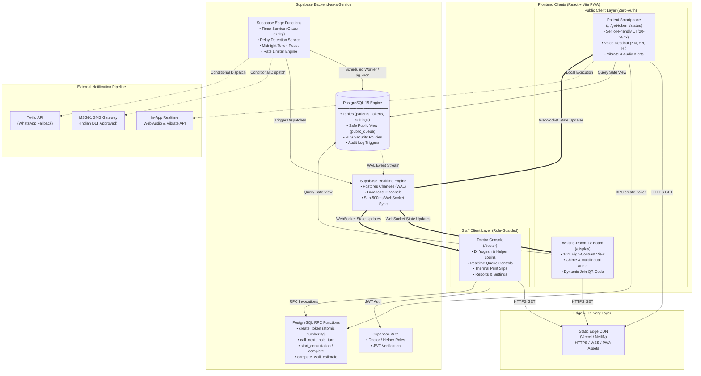
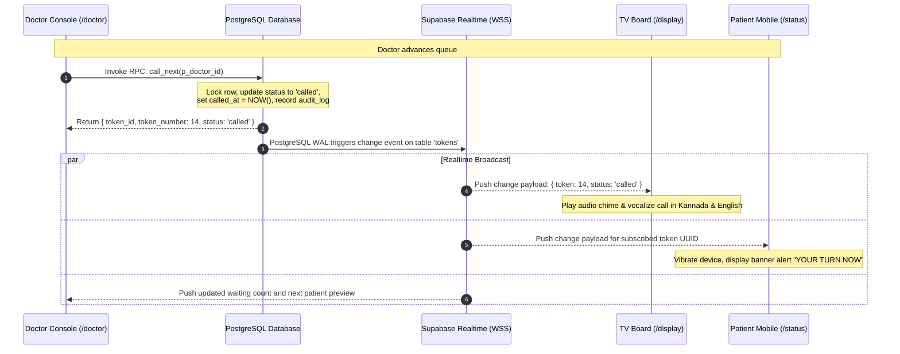

# System Architecture & Technical Design

## Document Details
- **Project**: Digital Queue Management System
- **Clinic**: Dhanvantri Clinic (Dr Yogesh)
- **Institution**: K. S. Institute of Technology, Dept. of CSE (25BCP308)
- **Document Version**: 1.0.0

---

## 1. Architectural Overview

The Dhanvantri Clinic Queue Management System uses an event-driven, decoupled client-server architecture. The frontend is a single Progressive Web App (PWA) built with React and Vite that provides two distinct interfaces: a **Zero-Auth Public Interface** for patients and the waiting-room TV display, and a **Role-Guarded Doctor Console** for Dr Yogesh and his clinic assistant.

Supabase acts as the complete backend-as-a-service (BaaS), handling relational data persistence in PostgreSQL, authentication, row-level security (RLS), real-time WebSocket state distribution, atomic transactional logic via Postgres Functions (RPC), and automated background timers via Supabase Edge Functions.

---

## 2. System Architecture Diagram

---

## 3. Subsystem Breakdown

### 3.1 Public Patient Interface (`/`, `/get-token`, `/status`)
- **Technology**: React 18, Tailwind CSS, Lucide Icons, Web Speech API, Web Vibration API.
- **Execution Model**: Runs completely client-side in the patient's browser without requiring account registration.
- **Security**: Can only query the sanitized `public_queue` database view or read personal token progress via an unguessable token UUID/session key.
- **Resilience**: Caches the last known queue position in browser memory and IndexedDB. In the event of cell-tower drops in BTM Layout, the UI displays an offline indicator with the cached status instead of a blank screen.

### 3.2 Waiting-Room TV Display Board (`/display`)
- **Technology**: Full-screen kiosk layout optimized for 1080p and 4K displays.
- **Execution Model**: Persistent WebSocket listener to the Supabase Realtime channel `room:clinic-display`.
- **Audio Pipeline**: Plays an acoustic chime upon token status changes, followed by sequential speech synthesis:
  1. Kannada: `"ಟೋಕನ್ ಸಂಖ್ಯೆ 14, ದಯವಿಟ್ಟು ವೈದ್ಯರ ಕೋಣೆಗೆ ಬನ್ನಿ."`
  2. English: `"Token number 14, please proceed to the doctor's room."`

### 3.3 Doctor Console (`/doctor`)
- **Technology**: React 18, shadcn/ui components, Recharts for clinical analytics.
- **Authentication**: Authenticated via Supabase Auth. Issues a secure JWT containing the user's role (`doctor` or `helper`).
- **Features**:
  - Direct execution of atomic stored procedures for queue manipulation.
  - Silent thermal printing of token slips using browser CSS `@media print` rules targeting 58mm/80mm receipt formats.
  - Distress alert listener with auditory priority bells when a patient triggers `"I need help"`.

### 3.4 Supabase Core Backend
- **PostgreSQL 15**: Serves as the single source of truth. All transactional state transitions are validated through foreign keys and CHECK constraints.
- **Row Level Security (RLS)**: Enforces that unauthenticated anonymous clients cannot inspect sensitive fields such as phone numbers, caregiver details, or internal clinical audit records.
- **RPC Layer**: Encapsulates concurrency-critical operations (token number generation, priority interleaving, queue reordering) to eliminate race conditions.
- **Edge Functions & Scheduled Jobs**:
  - `cron-daily-reset`: Triggers at 00:00 IST daily to archive tokens and reset daily sequence counters.
  - `timer-grace-period`: Evaluates tokens placed in `missed` status, automatically re-inserting them behind the active consultation once the 5-minute countdown expires.
  - `alert-delay-detector`: Scans for consultations exceeding 1.5× the running average, automatically updating waiting estimates and flagging doctor delays.

---

## 4. Real-Time Synchronization Strategy

### Key Principles of the Sync Strategy:
1. **Single Source of Truth**: State is never maintained exclusively in browser memory. Every mutation flows through PostgreSQL.
2. **Postgres Logical Replication (WAL)**: The Supabase Realtime daemon monitors write-ahead logs and broadcasts event payloads to active WebSocket clients within 150–300 milliseconds.
3. **Optimistic UI with Reversion**: Doctor console buttons show instantaneous visual feedback while awaiting RPC confirmation. If a network interruption occurs, the UI rolls back and presents an explicit retry notification.
4. **Heartbeat & Exponential Backoff**: When patient smartphones enter sleep mode or lose network connectivity in the Sandhya Theater Complex basement, the client automatically re-syncs state immediately upon network resumption.

