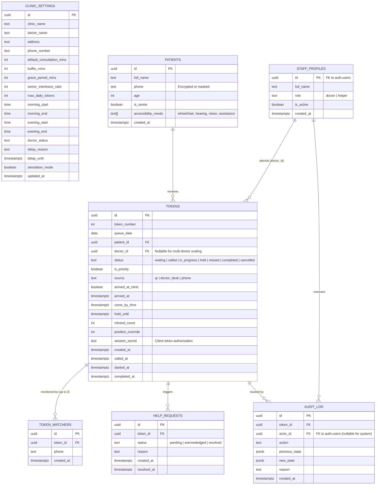

# Database Design & Security Specification

## Document Details
- **Project**: Digital Queue Management System
- **Clinic**: Dhanvantri Clinic (Dr Yogesh)
- **Institution**: K. S. Institute of Technology, Dept. of CSE (25BCP308)
- **Document Version**: 1.0.0

---

## 1. Entity-Relationship (ER) Diagram



---

## 2. Table Schemas & Column Definitions

### 2.1 `clinic_settings`
Single-row configuration table containing clinic operational parameters.
```sql
CREATE TABLE clinic_settings (
    id UUID PRIMARY KEY DEFAULT gen_random_uuid(),
    clinic_name TEXT NOT NULL DEFAULT 'Dhanvantri Clinic',
    doctor_name TEXT NOT NULL DEFAULT 'Dr Yogesh',
    address TEXT NOT NULL DEFAULT 'Sandhya Theater Complex, VP Road, BTM Layout, Bengaluru',
    phone_number TEXT NOT NULL DEFAULT '+91 98765 43210',
    default_consultation_mins INT NOT NULL DEFAULT 8 CHECK (default_consultation_mins BETWEEN 2 AND 60),
    buffer_mins INT NOT NULL DEFAULT 15 CHECK (buffer_mins BETWEEN 0 AND 60),
    grace_period_mins INT NOT NULL DEFAULT 5 CHECK (grace_period_mins BETWEEN 1 AND 30),
    senior_interleave_ratio INT NOT NULL DEFAULT 3 CHECK (senior_interleave_ratio BETWEEN 1 AND 10),
    max_daily_tokens INT NOT NULL DEFAULT 100 CHECK (max_daily_tokens > 0),
    morning_start TIME NOT NULL DEFAULT '09:30:00',
    morning_end TIME NOT NULL DEFAULT '13:30:00',
    evening_start TIME NOT NULL DEFAULT '17:30:00',
    evening_end TIME NOT NULL DEFAULT '21:30:00',
    doctor_status TEXT NOT NULL DEFAULT 'available' CHECK (doctor_status IN ('available', 'break', 'emergency', 'off_duty')),
    delay_reason TEXT DEFAULT NULL,
    delay_until TIMESTAMPTZ DEFAULT NULL,
    simulation_mode BOOLEAN NOT NULL DEFAULT FALSE,
    updated_at TIMESTAMPTZ NOT NULL DEFAULT NOW()
);
```

### 2.2 `staff_profiles`
Associates Supabase authenticated accounts with clinic authorization roles.
```sql
CREATE TABLE staff_profiles (
    id UUID PRIMARY KEY REFERENCES auth.users(id) ON DELETE CASCADE,
    full_name TEXT NOT NULL,
    role TEXT NOT NULL CHECK (role IN ('doctor', 'helper')),
    is_active BOOLEAN NOT NULL DEFAULT TRUE,
    created_at TIMESTAMPTZ NOT NULL DEFAULT NOW()
);
```

### 2.3 `patients`
Stores essential patient demographics without exposing medical records.
```sql
CREATE TABLE patients (
    id UUID PRIMARY KEY DEFAULT gen_random_uuid(),
    full_name TEXT NOT NULL,
    phone TEXT, -- Optional for phone-free walk-ins
    age INT NOT NULL CHECK (age >= 0 AND age <= 125),
    is_senior BOOLEAN GENERATED ALWAYS AS (age >= 60) STORED,
    accessibility_needs TEXT[] DEFAULT '{}',
    created_at TIMESTAMPTZ NOT NULL DEFAULT NOW()
);
```

### 2.4 `tokens`
Tracks queue state, timeline milestones, priority classification, and transit indicators.
```sql
CREATE TABLE tokens (
    id UUID PRIMARY KEY DEFAULT gen_random_uuid(),
    token_number INT NOT NULL,
    queue_date DATE NOT NULL DEFAULT CURRENT_DATE,
    patient_id UUID NOT NULL REFERENCES patients(id) ON DELETE CASCADE,
    doctor_id UUID REFERENCES staff_profiles(id) ON DELETE SET NULL, -- Nullable for multi-doctor scaling
    status TEXT NOT NULL DEFAULT 'waiting' CHECK (status IN ('waiting', 'called', 'in_progress', 'hold', 'missed', 'completed', 'cancelled')),
    is_priority BOOLEAN NOT NULL DEFAULT FALSE,
    source TEXT NOT NULL DEFAULT 'qr' CHECK (source IN ('qr', 'doctor_desk', 'phone')),
    arrived_at_clinic BOOLEAN NOT NULL DEFAULT FALSE,
    arrived_at TIMESTAMPTZ DEFAULT NULL,
    come_by_time TIMESTAMPTZ DEFAULT NULL,
    hold_until TIMESTAMPTZ DEFAULT NULL,
    missed_count INT NOT NULL DEFAULT 0,
    position_override INT DEFAULT NULL,
    session_secret UUID NOT NULL DEFAULT gen_random_uuid(), -- Authorizes patient actions
    created_at TIMESTAMPTZ NOT NULL DEFAULT NOW(),
    called_at TIMESTAMPTZ DEFAULT NULL,
    started_at TIMESTAMPTZ DEFAULT NULL,
    completed_at TIMESTAMPTZ DEFAULT NULL,
    CONSTRAINT uq_daily_token UNIQUE (queue_date, token_number)
);

CREATE INDEX idx_tokens_queue_date_status ON tokens(queue_date, status);
CREATE INDEX idx_tokens_created_at ON tokens(created_at);
```

### 2.5 `token_watchers`
Facilitates caregiver proxy tracking (up to 3 family members per token).
```sql
CREATE TABLE token_watchers (
    id UUID PRIMARY KEY DEFAULT gen_random_uuid(),
    token_id UUID NOT NULL REFERENCES tokens(id) ON DELETE CASCADE,
    phone TEXT NOT NULL,
    created_at TIMESTAMPTZ NOT NULL DEFAULT NOW(),
    CONSTRAINT uq_token_watcher UNIQUE (token_id, phone)
);
```

### 2.6 `help_requests`
Maintains records of patient distress requests submitted from mobile devices.
```sql
CREATE TABLE help_requests (
    id UUID PRIMARY KEY DEFAULT gen_random_uuid(),
    token_id UUID NOT NULL REFERENCES tokens(id) ON DELETE CASCADE,
    status TEXT NOT NULL DEFAULT 'pending' CHECK (status IN ('pending', 'acknowledged', 'resolved')),
    reason TEXT DEFAULT 'Assistance requested at clinic',
    created_at TIMESTAMPTZ NOT NULL DEFAULT NOW(),
    resolved_at TIMESTAMPTZ DEFAULT NULL
);
CREATE INDEX idx_help_requests_pending ON help_requests(status) WHERE status = 'pending';
```

### 2.7 `audit_log`
Chronicles all manual overrides, reorders, cancellations, and doctor delays.
```sql
CREATE TABLE audit_log (
    id UUID PRIMARY KEY DEFAULT gen_random_uuid(),
    token_id UUID REFERENCES tokens(id) ON DELETE SET NULL,
    actor_id UUID REFERENCES staff_profiles(id) ON DELETE SET NULL,
    action TEXT NOT NULL,
    previous_state JSONB DEFAULT NULL,
    new_state JSONB DEFAULT NULL,
    reason TEXT DEFAULT NULL,
    created_at TIMESTAMPTZ NOT NULL DEFAULT NOW()
);
CREATE INDEX idx_audit_log_token ON audit_log(token_id);
```

---

## 3. Sanitized Public Database View (`public_queue`)

To guarantee privacy, the public and TV display screens **never query the raw `patients` table**. They consume the `public_queue` view:

```sql
CREATE OR REPLACE VIEW public_queue AS
SELECT 
    t.id AS token_id,
    t.token_number,
    t.queue_date,
    t.status,
    t.is_priority,
    t.arrived_at_clinic,
    t.come_by_time,
    t.position_override,
    t.created_at,
    t.called_at,
    -- Compute initials only (e.g. "Ramesh Kumar" -> "R. K.")
    (
        SELECT string_agg(upper(left(part, 1)) || '.', ' ')
        FROM unnest(string_to_array(p.full_name, ' ')) AS part
    ) AS patient_initials,
    p.is_senior,
    p.accessibility_needs
FROM tokens t
JOIN patients p ON t.patient_id = p.id
WHERE t.queue_date = CURRENT_DATE
  AND t.status IN ('waiting', 'called', 'in_progress', 'hold')
ORDER BY 
    CASE 
        WHEN t.status = 'in_progress' THEN 1
        WHEN t.status = 'called' THEN 2
        WHEN t.status = 'hold' THEN 3
        ELSE 4
    END,
    COALESCE(t.position_override, t.token_number) ASC;
```

---

## 4. Row Level Security (RLS) Policies

All tables have RLS enabled (`ALTER TABLE ... ENABLE ROW LEVEL SECURITY;`).

### Summary of Policies:
1. `clinic_settings`:
   - `SELECT`: Allowed for public anon and authenticated users.
   - `UPDATE`: Restricted to authenticated users with `role = 'doctor'`.
2. `staff_profiles`:
   - `SELECT`: Authenticated users only.
   - `UPDATE / INSERT`: Authenticated users with `role = 'doctor'`.
3. `patients`:
   - `SELECT`: Authenticated staff (`doctor` or `helper`) only.
   - `INSERT`: Open to public anon (via RPC `create_token` or security definer).
4. `tokens`:
   - `SELECT`: Authenticated staff have full read access. Public anon can read rows matching their specific `session_secret` (stored in client local session).
   - `UPDATE`: Authenticated staff have full write access. Public anon can only update `arrived_at_clinic = TRUE` or `status = 'cancelled'` for their own `session_secret`.
5. `public_queue`:
   - Read access granted to `anon` and `authenticated`.
6. `help_requests`:
   - `INSERT`: Allowed for anon (with valid `token_id`).
   - `SELECT / UPDATE`: Authenticated staff only.
7. `audit_log`:
   - `SELECT`: Authenticated doctor only.
   - `INSERT`: Trigger-based or authenticated staff.

---

## 5. PostgreSQL Stored Procedures (RPC Functions)

All critical queue logic is executed within atomic Postgres transactions to prevent race conditions:

| Function Signature | Role Permitted | Description |
| :--- | :--- | :--- |
| `create_token(p_full_name TEXT, p_phone TEXT, p_age INT, p_accessibility TEXT[], p_source TEXT)` | Anon & Staff | Atomically increments daily sequence, records patient and token, calculates estimated arrival time, and returns token UUID + secret. |
| `call_next(p_doctor_id UUID)` | Staff | Selects next eligible token considering senior interleaving rules, changes status to `called`, updates timestamp, and notifies Realtime channel. |
| `start_consultation(p_token_id UUID)` | Staff | Transitions token from `called` to `in_progress`, marking `started_at = NOW()`. |
| `complete_consultation(p_token_id UUID)` | Staff | Marks token `completed`, sets `completed_at = NOW()`, logs elapsed duration, and automatically invokes wait-time recalculation. |
| `mark_missed(p_token_id UUID)` | Staff | Marks token `missed`, increments `missed_count`, and triggers a 5-minute grace-period timer. |
| `hold_turn(p_token_id UUID, p_hold_mins INT)` | Staff | Sets token status to `hold` and `hold_until = NOW() + INTERVAL '1 minute' * p_hold_mins`. |
| `reorder_queue(p_token_ids UUID[], p_reason TEXT)` | Staff | Updates `position_override` across an array of tokens and inserts an audit trail entry. |
| `compute_wait_estimate(p_token_id UUID)` | Public & Staff | Returns estimated wait duration in minutes, standard deviation range, and doctor delay offset. |

