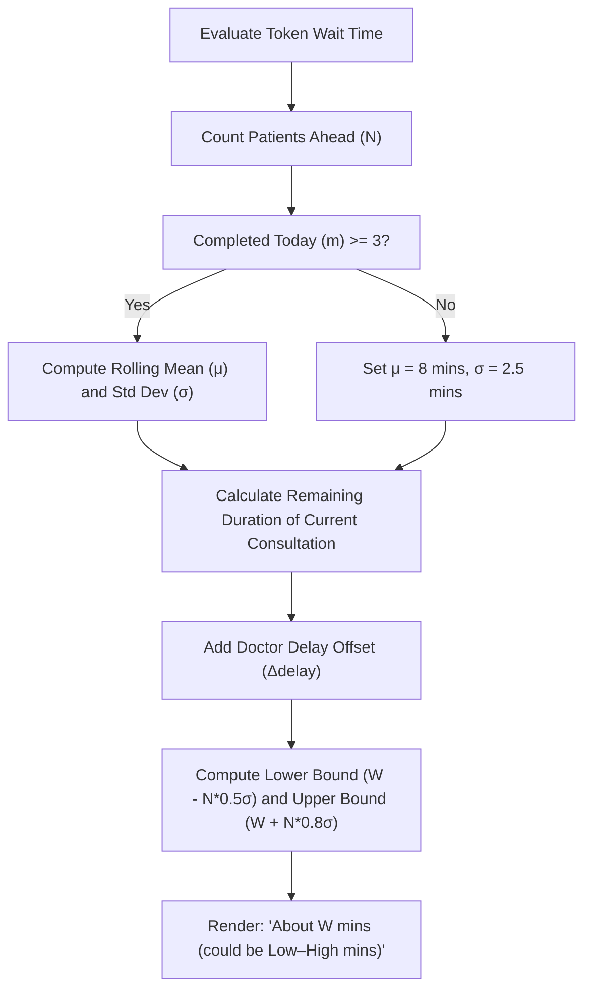
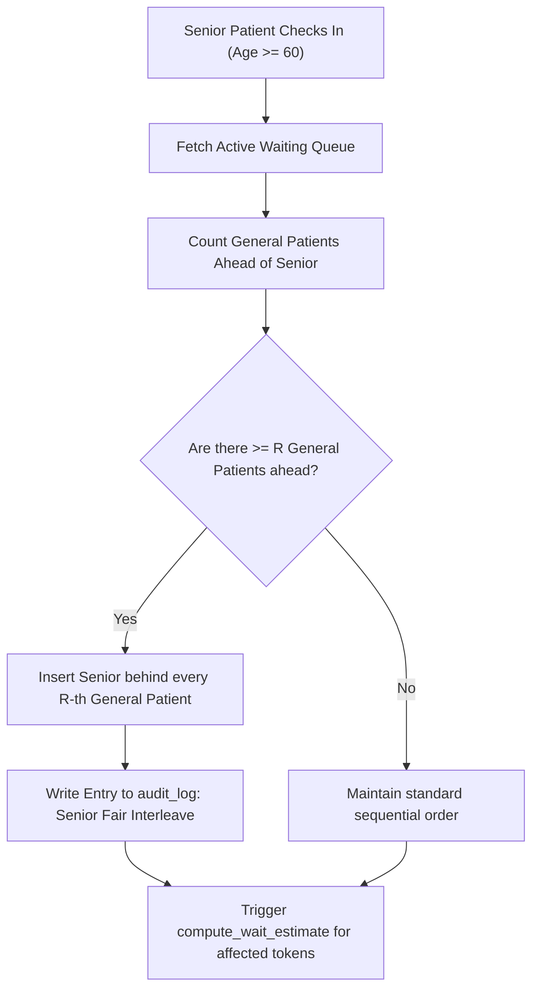
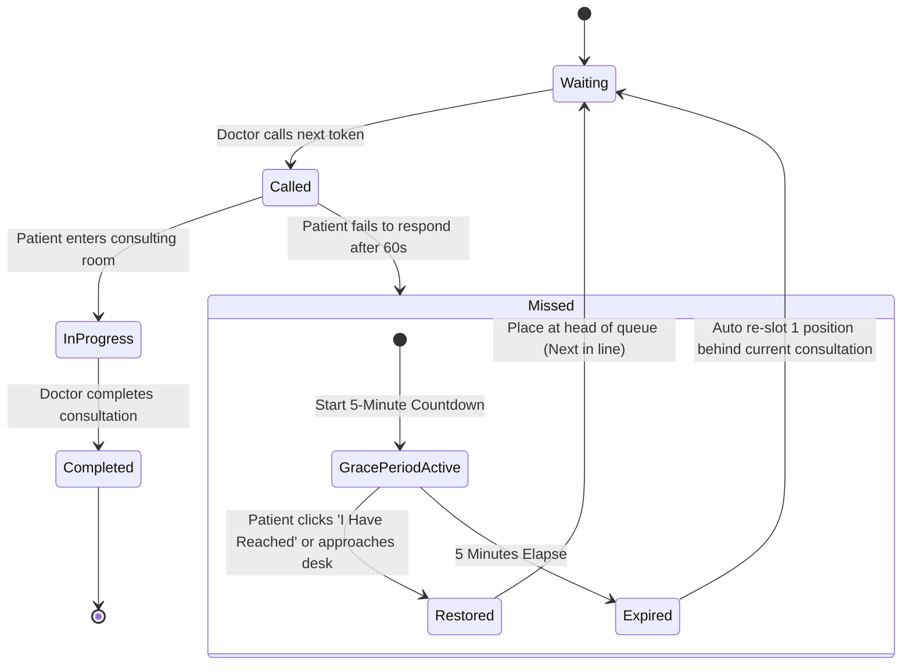

# Features & Algorithmic Logic Specifications

## Document Details
- **Project**: Digital Queue Management System
- **Clinic**: Dhanvantri Clinic (Dr Yogesh)
- **Institution**: K. S. Institute of Technology, Dept. of CSE (25BCP308)
- **Document Version**: 1.0.0

---

## 1. The 11 Differentiating Features

### 1.1 Phone-Free Check-In
- **Mechanism**: Walk-in patients without smartphones can obtain a token through two streamlined pathways:
  1. **Doctor/Helper Desk Entry**: Staff enters the patient's name and age into the Quick Walk-In widget in `/doctor`.
  2. **Thermal Slip Generation**: The system automatically issues a print layout for 58mm or 80mm thermal receipt printers featuring the clinic header, large 72pt token number, timestamp, and a companion tracking QR code for family members.
  3. **Display Board Follow-Along**: Patients without physical slips can follow progress by reading their assigned token number on the waiting-room TV display.

### 1.2 "Come Later" Smart Arrival Guidance
- **Mechanism**: Rather than requiring patients to wait in the clinic's cramped reception area at Sandhya Theater Complex, the system computes a personalized arrival milestone:
  $$\text{Target Arrival Time} = \text{Estimated Call Time} - \text{Clinic Buffer}$$
- **Default Buffer**: Configurable in clinic settings (default: 15 minutes).
- **Physical Check-In**: Upon arriving at the building, the patient taps `"I Have Reached the Clinic"`. This updates the doctor console with a green arrival indicator, signaling to Dr Yogesh that the patient is physically present in the lobby.

### 1.3 Family & Caregiver Proxy
- **Mechanism**: Recognizes that elderly patients are often assisted by adult children or neighbors.
- **Capacity**: Up to 3 independent phone numbers can be attached as watchers to a single token.
- **WhatsApp Integration**: The status page generates a pre-formatted WhatsApp share link:
  ```
  "Tracking Dr Yogesh's queue for my father at Dhanvantri Clinic: Token #14. Currently 3 patients ahead. Live link: https://dhanvantri.clinic/status?id=..."
  ```
- **Simultaneous Notifications**: Whenever the primary token advances to `"Get Ready"` or `"Your Turn"`, all registered proxy phone numbers receive notification events.

### 1.4 Senior Care Lane (Fair Interleaving)
- **Automatic Classification**: Any patient registering with age $\ge 60$ is automatically flagged with `is_senior = TRUE`.
- **Fair Interleaving Algorithm**: Avoids queue starvation for general patients while prioritizing seniors. With a default ratio of $R = 3$, the system schedules one senior patient after every 3 general patients.
- **Audit Logging**: Every interleaving adjustment automatically records a reason in the `audit_log` table (e.g., `"Senior Fair Interleave: Moved Token #18 ahead of #16 based on 3:1 policy"`).

### 1.5 Honest Wait-Time Range
- **Philosophy**: Avoid single-number guarantees (e.g., "Wait: 20 mins") that cause frustration when a case runs complex.
- **Display Format**: Displays a bounded range:
  $$\text{"About } \mu \text{ minutes (could be } \mu - \sigma \text{ to } \mu + 1.5\sigma \text{ mins)}"$$
- **Contextual Transparency**: When Dr Yogesh takes an emergency or unscheduled break, the status display explicitly appends: *"Doctor is running 12 mins late due to an emergency consultation."*

### 1.6 "Never Lose Your Turn" Grace Period & Re-Slotting
- **Problem Solved**: Patients briefly stepping out to a pharmacy or restroom who miss their call.
- **Step 1 (Missed Trigger)**: When Dr Yogesh calls a token and the patient is not present, tapping `"Mark Missed"` does not cancel the patient.
- **Step 2 (Grace Period)**: A 5-minute countdown begins. If the patient taps `"I Have Reached"` or returns to the desk during this window, their turn is restored.
- **Step 3 (Automatic Re-Slotting)**: If the countdown expires, the patient is automatically re-slotted exactly **one position behind the next patient currently in consultation**, preserving their investment in the queue while respecting incoming patients.
- **Step 4 (Doctor Hold)**: Dr Yogesh can also tap `"Patient Stepped Out"` to manually freeze a token for a specified number of minutes.

### 1.7 Multilingual Voice Announcements & Chime
- **Hardware Target**: Audio plays both on the central waiting-room TV display and directly through the patient's mobile speaker.
- **Acoustic Design**: A pleasant two-tone chime (440Hz followed by 880Hz) plays first, followed by clear synthetic vocalization.
- **Language Sequence**:
  - Kannada: *"ಟೋಕನ್ ಸಂಖ್ಯೆ 14, ದಯವಿಟ್ಟು ವೈದ್ಯರ ಕೋಣೆಗೆ ಬನ್ನಿ."*
  - English: *"Token number 14, please proceed to the doctor's room."*
  - Hindi: *"टोकन नंबर 14, कृपया डॉक्टर के कमरे में आएं।"*

### 1.8 Comprehensive Accessibility Profiling
- **Check-In Options**:
  - Mobility: Wheelchair / Walker assistance.
  - Sensory: Hearing impairment or visual impairment.
  - Personal: Needs general physical assistance.
- **Console Indication**: Displays prominent badges on the doctor's queue screen so Dr Yogesh or the helper can open the door or prepare accessibility ramps before calling.
- **Sensory Accommodation**: Patients flagged with hearing impairment receive repeated haptic vibration pulses (`navigator.vibrate([300, 100, 300, 100, 500])`) and high-contrast full-screen visual flashes upon turn call.

### 1.9 Doctor-Delay Transparency
- **Console Presets**: Dr Yogesh can tap one-click status triggers:
  - *"Emergency Case (Add 15 mins)"*
  - *"Clinical Break (Until 1:30 PM)"*
  - *"Running 20 mins late"*
- **Automatic System Response**: Instantly adjusts wait estimates and suggested arrival times across all connected patient screens and TV displays without page reloads.

### 1.10 "Best Time to Visit" Forecast
- **Mechanism**: Aggregates historic hourly token volumes and average consultation durations from the previous 4 weeks.
- **Visual Presentation**: An intuitive hourly bar chart on the public home page displaying historical congestion levels:
  - 09:30 - 10:30 AM: Peak Congestion (High Wait)
  - 11:30 - 12:30 PM: Moderate Flow
  - 05:30 - 06:30 PM: Peak Congestion
  - 07:30 - 08:30 PM: Best Time to Visit (Low Wait)

### 1.11 Weekly Clinical Operations Report
- **Metrics Tracked**: Total patients served, average consultation duration, average lobby wait duration, percentage of senior citizens served, and no-show/cancellation rates.
- **Data Export**: Generates standardized clinical CSV spreadsheets and printable PDF summaries for clinic records and college evaluation.

---

## 2. Smart Logic & Mathematical Formulations

### 2.1 Wait-Time Estimation Formula

Let $N$ be the number of active patients ahead of target token $T_i$ in the waiting queue ($S = \{T_1, T_2, \dots, T_k\}$).

1. **Rolling Consultation Mean ($\mu_{\text{rolling}}$)**:
   Calculated from the completed consultations on the current day (sample size $m$, where $m \ge 3$):
   $$\mu_{\text{rolling}} = \frac{1}{m} \sum_{j=1}^{m} D_j$$
   *(If $m < 3$, default to `default_consultation_mins` = 8 minutes).*

2. **Standard Deviation ($\sigma$)**:
   $$\sigma = \sqrt{\frac{1}{m-1} \sum_{j=1}^{m} (D_j - \mu_{\text{rolling}})^2}$$
   *(If $m < 3$, default $\sigma = 2.5$ minutes).*

3. **Active Patient Remaining Duration ($D_{\text{current}}$)**:
   For the patient currently inside the consulting room:
   $$D_{\text{current}} = \max\left(1, \mu_{\text{rolling}} - \text{elapsed\_time}(T_{\text{active}})\right)$$

4. **Total Estimated Wait Time ($W_i$)**:
   $$W_i = D_{\text{current}} + (N - 1) \cdot \mu_{\text{rolling}} + \Delta_{\text{delay}}$$
   Where $\Delta_{\text{delay}}$ represents doctor-broadcasted delays or active break intervals.

5. **Reported Wait Range**:
   - Lower Bound: $\max(2, W_i - (N \cdot 0.5 \sigma))$
   - Upper Bound: $W_i + (N \cdot 0.8 \sigma)$



---

### 2.2 Senior Interleaving Fair Policy

Let $R$ be the interleaving ratio (default $R = 3$).



---

### 2.3 Missed-Turn Grace Period State Machine


